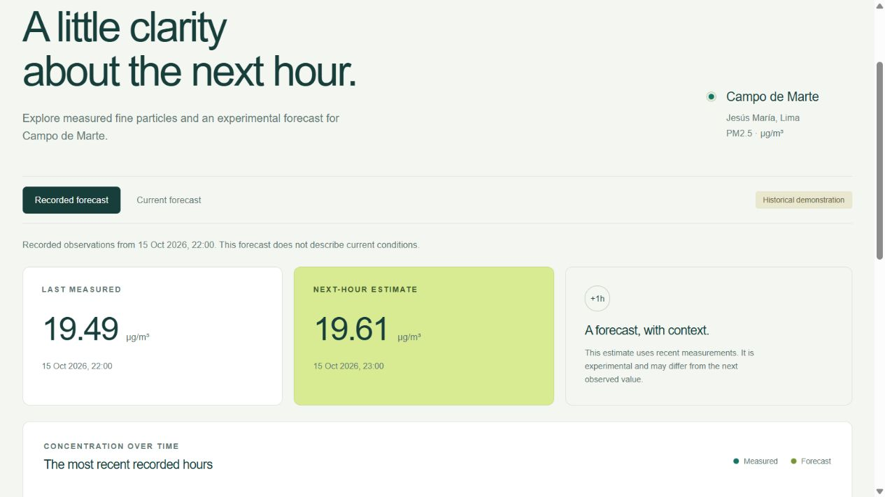
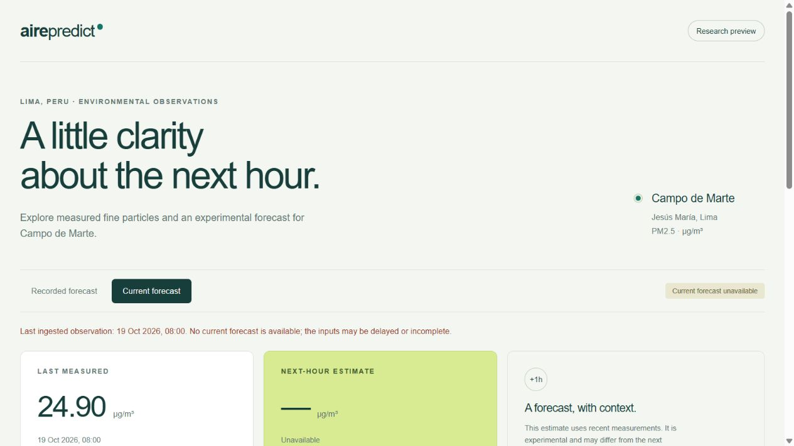

# AirePredict Perú: operación y mantenimiento del MVP

## Producto y alcance

Aplicación pública: https://airpredict-4u3c.onrender.com/

Código y automatizaciones: https://github.com/Miguel7293/AirPredict

AirePredict estima la concentración de PM2.5 una hora después de la última observación de Campo de Marte, ubicación OpenAQ 2415, sensor 4672. La interfaz está en inglés. Las mediciones auxiliares de La Huaca y Macacará no se presentan como estaciones actuales de Lima. El resultado es experimental y no sustituye mediciones oficiales.

La web incluye observación, predicción, fechas en Lima, gráfico con discontinuidades, explicación del modelo, instalación PWA, vista compacta y acceso a operaciones. Android añade consulta nativa, consulta histórica nativa, acceso a la web completa, widget de pantalla de inicio y notificaciones opcionales. El widget muestra su hora objetivo; Android decide cuándo ejecuta las actualizaciones en segundo plano.

## Arquitectura gratuita

Render ejecuta un contenedor Python 3.12 con FastAPI y un solo proceso. El servicio público es una proyección de lectura del estado publicado. No contiene una credencial de escritura de GitHub ni ejecuta entrenamientos desde solicitudes públicas.

GitHub Actions realiza las operaciones sobre la rama `runtime-state`, que conserva las mediciones, registro SQLite, artefactos y periodos de evaluación utilizados. Esa rama es pública: únicamente debe contener datos ambientales y metadatos técnicos, nunca claves ni datos personales. `main` contiene código, configuración y el modelo experimental de arranque.

El servicio consulta el estado cada diez minutos, descarga una revisión concreta y comprueba el registro y el hash del modelo antes de cambiar el enlace al nuevo directorio completo. Si falla la actualización conserva la última copia. Al reiniciar reconstruye su estado desde GitHub; si la rama todavía no contiene una publicación válida utiliza la demostración histórica incluida en la imagen.

Render gratuito puede suspender la instancia por inactividad. El primer acceso puede tardar y no existe garantía de disponibilidad continua. Esta arquitectura evita contratar almacenamiento; para un servicio con requisitos operativos más exigentes debe migrarse a almacenamiento persistente y alojamiento con garantías adecuadas. No se contrató el plan de pago.

## Entrenamiento supervisado y optimización

La variable objetivo es el cambio PM2.5(t+1) − PM2.5(t). Se suma la salida al valor actual y se limita la concentración mínima a cero. Las nueve características se construyen únicamente con t, t−1 y t−2 de una misma estación, más representaciones cíclicas de hora y día. No se imputan horas ausentes.

El histórico OEFA aporta 15 587 ejemplos completos de La Huaca y Macacará. OpenAQ/SENAMHI aporta 2 752 de Campo de Marte: 2 200 de entrenamiento, 282 de validación y 270 de prueba. Los cortes se realizan por la fecha del objetivo, en orden temporal. Las fuentes permanecen diferenciadas y comparten contrato de unidades y características.

Se compararon Ridge, Random Forest e HistGradientBoosting bajo tres regímenes: fuente, destino y combinación ponderada. Se exploraron 30 configuraciones; la selección utiliza MAE de validación. Para combinar fuentes se reparte el presupuesto de peso OEFA entre sus filas, evitando que su mayor cantidad domine el entrenamiento.

La configuración combinada seleccionada usa HistGradientBoosting, siete hojas máximas, 120 iteraciones, tasa 0,05, L2 de 5 y un mínimo de 20 ejemplos por hoja. El peso total OEFA equivale al del destino. Una vez seleccionada, se ajustó con entrenamiento y validación y se evaluó en prueba.

| Modelo de referencia | MAE de prueba | RMSE de prueba | R² |
|---|---:|---:|---:|
| Persistencia | 2,0699 | 2,9319 | 0,6040 |
| Combinado seleccionado | 2,0177 | 2,8815 | 0,6175 |

MAE y RMSE se expresan en µg/m³. R² no es un porcentaje de acierto. La mejora observada es pequeña, el intervalo bootstrap diario incluye cero y solo el 37,5 % de las horas de prueba tuvo ventanas completas. La prueba original ya fue consultada; no puede reutilizarse como confirmación independiente de nuevas decisiones.

La descripción completa de limpieza, alternativas e hiperparámetros está en [REPORTE_ENTRENAMIENTO.md](../reports/oefa_campo_marte_v1/REPORTE_ENTRENAMIENTO.md). El CSV adicional de Kaggle queda fuera del pronóstico horario por falta de contrato temporal y de estación compatible.

## Pipelines y horarios

| Archivo | Activación | Resultado |
|---|---|---|
| `ci.yml` | Push, PR, manual y llamada desde despliegue | Pruebas Python y contenedor con arranque y predicción real |
| `deploy.yml` | Main y manual | Imagen identificada por commit en GHCR, despliegue de ese commit y comprobación remota |
| `operations.yml` | Horario y manual | Ingesta, evaluación, monitorización, respaldo, simulación o recuperación |
| `rollback.yml` | Manual | Recupera y verifica un commit de aplicación con entrega previa correcta |
| `android.yml` | Cambios Android y manual | Compilación, análisis y APK; pruebas de dispositivo en ejecución manual |

Horarios de mantenimiento en UTC: ingesta al minuto 17 de cada hora, monitorización a las 08:37 diariamente, entrenamiento los lunes a las 09:47 y respaldo a las 07:27 diariamente. GitHub puede retrasar las ejecuciones. Las escrituras del estado de modelos comparten un grupo de exclusión mutua. Las entregas y recuperaciones de la aplicación comparten otro; el servidor solo consume copias completas del estado. Todos publican resultados consultables.

La ingesta usa OpenAQ autenticado si existe `OPENAQ_API_KEY`. En ausencia de clave, actualiza únicamente el archivo histórico público retrasado, con una etiqueta explícita. Ese archivo no alimenta el almacén de observaciones actuales ni habilita pronósticos en vivo.

El proceso autenticado también emite y registra una predicción cuando existe una ventana realmente fresca. Estas emisiones quedan guardadas en el estado durable para compararlas con resultados posteriores. Las solicitudes recibidas por la web gratuita pueden registrar emisiones locales adicionales, pero esas escrituras temporales no se consideran historial durable del monitor.

## Aprobación y recuperación de modelos

Se necesitan al menos 168 ejemplos completos posteriores a los periodos consumidos. El entrenamiento usa una receta congelada y reserva fechas posteriores. Cada evaluación queda consumida incluso si falla el entrenamiento o se rechaza el candidato. Las características de entrenamiento y evaluación se guardan con hashes.

La política inicial exige cantidad de ejemplos, siete días observados, cobertura, mejora de MAE frente al activo, ventaja frente a persistencia y límites de RMSE, sesgo y error en concentraciones altas. También exige una cota superior negativa del intervalo bootstrap diario. Los umbrales son provisionales; no constituyen un estándar ambiental. El modelo inicial se registra como experimental, sin simular que aprobó esta política.

Un candidato rechazado o un fallo de entrenamiento conserva el modelo activo. Una activación mantiene la versión anterior compatible. El servicio intenta recuperarla si falla la carga o la predicción; el siguiente mantenimiento puede consolidar esa recuperación en el estado durable cuando coincide con las versiones publicadas. El monitor revierte por degradación cuando dispone de resultados suficientes y la versión anterior muestra una mejora comprobada conforme a los controles del prototipo.

La recuperación de software y la de modelo son operaciones distintas. Un cambio de dependencias o características puede exigir recuperar el contenedor correspondiente, además del archivo del modelo.

## Configuración y secretos

Variables de GitHub: `APP_BASE_URL` con el origen HTTPS publicado.

Secretos: `RENDER_DEPLOY_HOOK` para desplegar el servicio; `OPENAQ_API_KEY` opcional para datos actuales. Las credenciales no pertenecen a la rama de estado, al APK ni al código. El acceso de escritura de Actions utiliza el token temporal del propio trabajo.

Render gratuito: `AIRPREDICT_ROOT=/tmp/airpredict-state/current` y `STATE_SYNC_REPOSITORY=Miguel7293/AirPredict`. Health check: `/ready`. Auto-deploy desactivado para que los cambios de código pasen por CI/CD.

El modo con disco y trabajos administrativos locales sigue disponible para una futura migración. En ese modo requiere `AIRPREDICT_ADMIN_TOKEN` de al menos 32 caracteres; las rutas de mutación lo validan. En la modalidad gratuita las operaciones se realizan desde GitHub Actions, con autenticación de GitHub.

## Procedimientos del equipo de mantenimiento

**Desplegar:** subir el cambio a main; revisar CI, construcción, despliegue del commit y comprobación de `/ready` y `/api/demo`. Si la verificación falla no se considera una entrega válida. Recuperar el despliegue anterior desde Render si el cambio no puede corregirse rápidamente.

**Reentrenar:** abrir Scheduled model maintenance → Run workflow → retrain. Revisar el informe y el registro. `skipped` significa falta de datos; `rejected` significa que el activo se mantiene por controles de calidad.

**Recuperar modelo:** ejecutar la acción manual rollback. Requiere que exista una versión anterior compatible. No se fabrica una versión anterior para aparentar una recuperación.

**Recuperar aplicación:** ejecutar Restore application version con el SHA completo de una entrega anterior correcta. El flujo comprueba esa condición y verifica la recuperación. El despliegue normal también intenta recuperar el último commit saludable si falla su comprobación final. La compatibilidad del modelo y entorno sigue siendo necesaria.

**Respaldar y restaurar:** ejecutar backup y descargar el artefacto. El ZIP usa copia online de SQLite e incluye un manifiesto de hashes. Para restaurar, verificar hashes e integridad, probar el estado aislado y publicar una revisión controlada de runtime-state. Conservar también el commit de código y entorno compatible. Los artefactos tienen retención de 30 días; el estado actual y su historial permanecen en la rama.

**Android:** descargar el APK del flujo o de la entrega publicada. Es un paquete de demostración firmado para pruebas, no una publicación en Play Store. Permitir notificaciones es opcional. Añadir el widget usa el mecanismo del launcher; no solicita ubicación ni permiso de superposición. Un launcher puede no ofrecer anclaje desde el aplicativo; en ese caso se añade desde la pantalla de inicio.

## Evidencia y límites pendientes

Se verificó también la restauración de un respaldo real descargado de GitHub: 23 archivos con hashes correctos, registro compatible y predicción histórica reproducida. Los enlaces a ejecuciones y comprobaciones finales se conservarán en `reports/ENTREGA_MVP.json`. Las pruebas incluyen separación temporal, integridad de artefactos, recuperación, autenticación, respaldo/restauración y actualización atómica del estado en Linux. Android añade compilación, análisis y comprobaciones de dispositivo.

La conexión autenticada de OpenAQ se verificó desde GitHub Actions: se aceptaron 34 horas y no se emitió un pronóstico actual porque faltaba una ventana suficientemente fresca. La clave se conserva como secreto de GitHub. Sin clave, la demostración y actualización histórica siguen disponibles. El archivo público tiene retraso y el servicio gratuito puede dormir. La disponibilidad de datos suficientes y buenas métricas se comprueba en cada ciclo, no se garantiza por el hecho de automatizarlo.

## Cierre de verificación

Se aprobaron 45 pruebas Python en Linux, tres flujos del cliente y seis pruebas de Android 15. Se verificaron una recuperación real de la aplicación desde GitHub Actions y la posterior entrega de la versión final. El registro de modelos se verificó mediante pruebas y simulación histórica aislada. Los horarios de mantenimiento están activos; las ejecuciones usadas como evidencia se iniciaron manualmente para validar sus resultados.

El APK está publicado en [v0.3.0](https://github.com/Miguel7293/AirPredict/releases/tag/v0.3.0), con suma SHA-256. El código de producción Android coincide con el de la etiqueta; el flujo de pruebas incorpora las correcciones posteriores de la infraestructura de pruebas. El informe [ENTREGA_MVP.json](../reports/ENTREGA_MVP.json) identifica las revisiones y ejecuciones comprobadas.

Las capturas [ANDROID_APP.png](../reports/ANDROID_APP.png) y [ANDROID_WIDGET_TEST.png](../reports/ANDROID_WIDGET_TEST.png) corresponden al emulador. La segunda muestra el widget en un host de pruebas; su tamaño en la pantalla de inicio lo determina el launcher. El estado sin pronóstico fresco es esperado con el retraso observado del proveedor.
