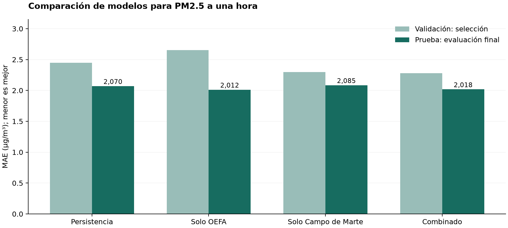
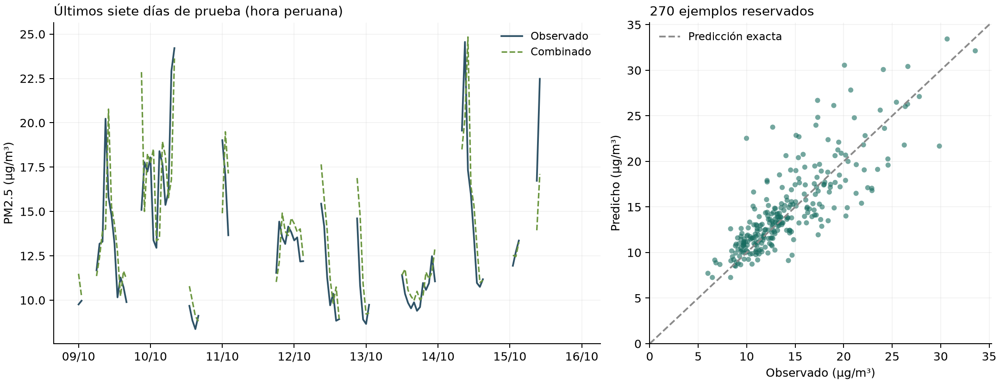

# Reporte del entrenamiento de AirePredict Perú

Fecha de ejecución registrada: **19 de octubre de 2026, 12:26, hora peruana**. Experimento: `oefa_campo_marte_v1`.

## 1. Resumen del resultado

**Sí se entrenaron los modelos.** Se evaluaron 30 configuraciones candidatas y se guardaron tres modelos finales: solo OEFA, solo Campo de Marte y combinado. Se incluyó persistencia como referencia sin entrenamiento.

El modelo combinado, HistGradientBoosting, fue elegido por el menor MAE de validación: **2,2786 µg/m³**. En los 270 ejemplos de prueba obtuvo **MAE 2,0177 µg/m³, RMSE 2,8815 µg/m³ y R² 0,6175**. El modelo de solo OEFA tuvo el mejor resultado numérico de prueba (MAE 2,0119), pero no se cambió la elección después de consultar ese conjunto.

La combinación redujo el MAE observado un **3,22 %** frente al modelo de solo Campo de Marte y un **2,52 %** frente a persistencia. Estas reducciones describen esta prueba; **no constituyen una mejora estadísticamente concluyente**. La cobertura de ejemplos evaluables fue del 37,5 % de las horas del periodo.

Este reporte se elaboró a partir de resultados, predicciones y modelos guardados. No se volvió a entrenar ni se cambiaron los hiperparámetros para mejorarlo.

## 2. Objetivo y datos

La tarea es una regresión supervisada: estimar la concentración de PM2.5 de Campo de Marte una hora después de la última medición. La unidad de salida es µg/m³.

El modelo aprende el cambio `PM2.5(t+1) − PM2.5(t)`. Para producir la concentración, se suma el cambio predicho al último valor medido y se limita el resultado mínimo a cero. No se entrenó un clasificador de categorías de calidad del aire.

| Fuente | Periodo utilizado | Observaciones horarias preparadas | Ejemplos supervisados completos |
|---|---|---:|---:|
| OEFA: La Huaca y Macacará | Diciembre de 2021 a diciembre de 2022 | 15 684 | 15 587 |
| OpenAQ/SENAMHI: Campo de Marte, ubicación 2415, sensor 4672 | 01/04/2026–15/10/2026 | 3 315 | 2 752 |

Se revisó el CSV original de 2 883 877 filas, pero no se entrenó con todas ellas: incluye otros contaminantes, intervalos diarios y registros sin hora utilizable. Se conservaron las dos series horarias reconstruibles. Para Campo de Marte se consultaron 198 días; 181 archivos respondieron correctamente y 17 fechas respondieron 404. Las ausencias están registradas en el manifiesto.

Las estaciones se mantuvieron diferenciadas. No se presentó La Huaca o Macacará como si fueran Campo de Marte. Se normalizaron unidades y tiempos, se excluyeron datos inválidos y no se rellenaron huecos con mediciones inventadas. Los valores cero numéricos se conservaron.

Cada ejemplo requiere cuatro horas consecutivas de la misma estación: t−2, t−1 y t para las entradas, y t+1 como objetivo. Por eso existen menos ejemplos que observaciones.

## 3. Características de entrada

Se utilizaron nueve características:

| Característica | Definición |
|---|---|
| pm25_now | Concentración observada en t |
| pm25_lag1 | Concentración observada en t−1 hora |
| pm25_lag2 | Concentración observada en t−2 horas |
| mean_last3 | Promedio de t, t−1 y t−2 |
| change_last1 | Cambio de t−1 a t |
| hour_sin, hour_cos | Representación cíclica de la hora peruana |
| weekday_sin, weekday_cos | Representación cíclica del día de la semana |

No se incorporaron meteorología ni valores futuros como entradas. No se usó el nombre de la fuente como predictor. La adaptación se realizó mediante datos compartidos y ponderaciones, no mediante una corrección instrumental certificada.

## 4. Separación temporal

Los cortes se aplicaron a la **fecha del objetivo t+1**, en hora peruana. No se utilizó una partición aleatoria.

| Subconjunto de Campo de Marte | Fechas de calendario | Ejemplos | Uso |
|---|---|---:|---|
| Entrenamiento | 01/04/2026–15/08/2026 | 2 200 | Ajustar candidatos |
| Validación | 16/08/2026–15/09/2026 | 282 | Elegir algoritmo, hiperparámetros y pesos |
| Prueba | 16/09/2026–15/10/2026 | 270 | Evaluar los modelos finales reservando fechas posteriores |

Los 15 587 ejemplos OEFA se añadieron únicamente al entrenamiento de los regímenes que usan esa fuente. La validación y la prueba fueron siempre de Campo de Marte y compartieron exactamente los mismos ejemplos entre alternativas.

Después de fijar la configuración por validación, se ajustaron nuevamente los modelos finales antes de evaluar la prueba:

- Solo OEFA: 15 587 ejemplos fuente.
- Solo Campo de Marte: 2 482 ejemplos de entrenamiento y validación.
- Combinado: 18 069 ejemplos, correspondientes a 15 587 OEFA y 2 482 Campo de Marte.

La evaluación pronostica una hora cada vez usando el historial real disponible en cada emisión. No representa una predicción recursiva de 30 días realizada desde una sola fecha inicial.

## 5. Búsqueda de hiperparámetros y adaptación

| Algoritmo | Parámetros explorados | Parámetros comunes |
|---|---|---|
| Ridge con StandardScaler | alpha: 1 y 100 | Escalador ajustado solo con datos de ajuste y sus pesos |
| HistGradientBoosting | max_leaf_nodes: 7 y 15 | 120 iteraciones, learning_rate=0,05, l2_regularization=5, min_samples_leaf=20, early_stopping=False |
| Random Forest | min_samples_leaf: 5 y 15 | 100 árboles, max_depth=10, max_features=1,0 |

Se probaron seis configuraciones para solo OEFA, seis para solo Campo de Marte y dieciocho para el combinado: seis configuraciones por cada presupuesto fuente de 0,1, 0,5 y 1,0. **Total: 30 candidatos y tres ajustes finales guardados.** La semilla fue 2026. La búsqueda es acotada; no prueba optimalidad global ni sustituye una validación temporal con varios cortes.

En el combinado, cada fila de Campo de Marte recibió peso 1 y cada fila OEFA recibió:

`peso_OEFA = presupuesto × número_de_ejemplos_destino / número_de_ejemplos_OEFA`

Se eligió presupuesto 1,0: ambas fuentes aportan el mismo peso agregado, aunque OEFA tiene más filas. En el ajuste final cada ejemplo OEFA pesó aproximadamente **0,15924**, frente a 1 por ejemplo de Campo de Marte.

Configuración seleccionada del combinado: **HistGradientBoostingRegressor**, 7 hojas máximas, 120 iteraciones, tasa 0,05, regularización L2 de 5 y un mínimo de 20 muestras por hoja. El early stopping interno se desactivó para evitar una partición interna aleatoria.

## 6. Métricas de validación y prueba

| Régimen | Modelo elegido en su régimen | MAE validación | MAE prueba | RMSE prueba | R² prueba | Sesgo prueba |
|---|---|---:|---:|---:|---:|---:|
| Persistencia | Sin entrenamiento | 2,4474 | 2,0699 | 2,9319 | 0,6040 | 0,1645 |
| Solo OEFA | Random Forest | 2,6514 | 2,0119 | 2,7127 | 0,6610 | -0,1219 |
| Solo Campo de Marte | HistGradientBoosting | 2,2994 | 2,0849 | 2,9509 | 0,5988 | 0,7599 |
| Combinado | HistGradientBoosting | 2,2786 | 2,0177 | 2,8815 | 0,6175 | 0,4681 |

MAE, RMSE y sesgo se expresan en µg/m³. Un sesgo positivo significa sobreestimación promedio. R² no es un porcentaje de aciertos. MAE mide la magnitud promedio del error absoluto; RMSE penaliza más los errores grandes.

Los resultados de validación corresponden a candidatos anteriores al ajuste final con entrenamiento y validación. Los resultados de prueba corresponden a esos modelos finales. No deben interpretarse como dos evaluaciones del mismo ajuste sobre distribuciones idénticas.

Para el combinado, la mediana del error absoluto en prueba fue **1,366 µg/m³** y su percentil 95 fue **6,174 µg/m³**. El mayor error observado fue **12,555 µg/m³**. El MAE promedio no garantiza errores pequeños en todos los casos.

Los cortes en las líneas indican horas no evaluables, no concentraciones iguales a cero. La línea diagonal del panel derecho representa predicción exacta.

## 7. Incertidumbre y cambios de distribución

Se hicieron 2 000 remuestreos de días completos sobre los 30 días de prueba para comparar errores de los mismos ejemplos. Para combinado menos solo Campo de Marte:

- Diferencia de MAE: **-0,0672 µg/m³**.
- Intervalo aproximado del 95 %: **[-0,1338, 0,0005] µg/m³**.

El intervalo contiene cero. Por tanto, la evidencia todavía no permite afirmar una mejora concluyente por agregar OEFA. El remuestreo por días conserva la dependencia dentro de cada día, pero no elimina toda la posible dependencia entre días ni sustituye otra evaluación futura.

La distribución del objetivo también cambia entre periodos:

| Periodo de Campo de Marte | Media | Mediana | Percentil 95 | Máximo |
|---|---:|---:|---:|---:|
| Entrenamiento | 27,11 | 20,29 | 54,45 | 344,50 |
| Validación | 17,19 | 15,21 | 31,03 | 38,34 |
| Prueba | 14,22 | 13,13 | 23,65 | 33,57 |

Todas las cifras son µg/m³. El periodo inicial incluye concentraciones bastante mayores que la prueba. Los valores extremos deben contrastarse con indicadores de calidad del proveedor; no se asumió que fueran errores ni se eliminaron por favorecer una métrica.

Como comprobación posterior, se evaluaron los modelos finales sobre los mismos 2 482 ejemplos iniciales de Campo de Marte:

| Modelo final | MAE en el periodo inicial | RMSE en el periodo inicial | Interpretación |
|---|---:|---:|---|
| Solo OEFA | 5,3307 | 11,7126 | Transferencia a destino; no fue su ajuste |
| Solo Campo de Marte | 3,3896 | 7,1457 | Datos utilizados en su ajuste final |
| Combinado | 3,4022 | 7,1492 | Datos utilizados en su ajuste final |

Estas métricas se calcularon al elaborar este reporte; no son pérdidas registradas durante el entrenamiento. En los dos modelos que usan Campo de Marte incluyen datos utilizados en el ajuste y no son una evaluación independiente. La menor magnitud del error de prueba respecto al periodo inicial no demuestra por sí sola ausencia de sobreajuste, dadas las diferentes distribuciones.

## 8. Limitaciones y decisión

1. Los 270 ejemplos representan solo el **37,5 % de 720 horas** del periodo de prueba. Las conclusiones se refieren a ventanas completas observadas; falta mejorar y evaluar la disponibilidad de pronósticos ante huecos.
2. Se evaluó una sola estación destino y un único corte temporal. No se ha demostrado generalización a otras ciudades o estaciones del año.
3. La zona horaria OEFA, la medianoche Excel y la equivalencia de inicio/final del intervalo siguen siendo supuestos explícitos pendientes del diccionario original.
4. Las etiquetas de calidad y la calibración instrumental no quedaron completamente verificadas con los archivos públicos descargados.
5. El conjunto de prueba ya se consultó. No debe reutilizarse repetidamente para elegir modificaciones y seguir llamándolo independiente. La siguiente iteración necesita otro periodo de confirmación o un esquema temporal anidado.
6. No se guardaron tiempos de entrenamiento por candidato, curvas de aprendizaje ni pérdidas por iteración. No se presentan cifras inventadas para esos apartados.

**Decisión:** conservar el combinado como candidato experimental para la demostración, porque fue seleccionado por validación. El menor MAE de prueba de solo OEFA se reporta, pero no se utiliza para una selección retroactiva. Antes de aprobar un modelo operativo se requieren más periodos de evaluación, cobertura suficiente y verificación de la fuente en vivo.

## 9. Artefactos y reproducibilidad

Los tres modelos entrenados se encuentran en `models/oefa_campo_marte_v1/`: `solo_oefa.joblib`, `solo_campo_marte.joblib` y `combinado.joblib`. Se volvieron a cargar y sus predicciones de prueba reprodujeron las métricas guardadas, con tolerancia numérica de 1e−10 en MAE.

- [Resultados completos de la ejecución](resultados.json): métricas, 30 candidatos, cortes, versiones y hashes de datos.
- [Predicciones individuales de prueba](predicciones_prueba.csv): objetivos reales y salida de cada modelo sobre las mismas fechas.
- [Verificación posterior de modelos finales](verificacion_modelos.json).
- Configuración: `config/experiment.json`. Ejecución de entrenamiento: `python -m airepredict experiment`.
- Generación de este reporte sin reentrenar: `python scripts/report_training.py`.

Versiones de la ejecución original: Python 3.12.14, NumPy 2.3.5, pandas 3.0.1, scikit-learn 1.9.1 y joblib 1.6.0. Los modelos siguen marcados como experimentales; que la aplicación local pueda utilizarlos no equivale a una aprobación de producción.
